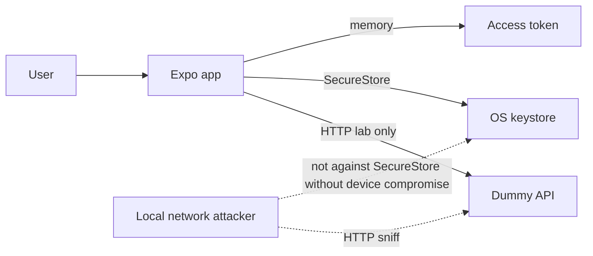

# Design, security and implementation evaluation

Date: 2026-11-25  
Scope: requirements, solution design, backlog, HTML prototype, dummy backend, and the current monorepo implementation (`packages/ui`, `packages/sdk`, `apps/mobile`).  
Lens: solutions-architect review for a **local-first learning project** that should still be conceptually ready for iOS/Android deployment.

This document is the evaluation that should have been produced before large-scale code generation. Code already exists; findings below judge both the **design** and the **current implementation**, and recommend **learning-meaningful alternatives**.

---

## 1. Executive verdict

The documentation set is unusually thorough for a learning repo: clear package boundaries, a sequenced backlog, and a sensible security *intent* (access token in memory, SecureStore for refresh material, server-side RBAC, config that cannot disable pinning).

The main risks are:

1. **Enterprise breadth before a proven vertical slice** — pinning, offline queues, WebView bridges, native modules and 100% SDK coverage appear before learners have a trustworthy auth story.
2. **Security theatre** — several controls are specified or named in code but not enforced on the real request path (HTTP + `InsecureDevTransport`, fake refresh, SSO that is credentials with different labels).
3. **Doc drift** — superseded three-repo layouts and duplicate backlog generations still compete for attention unless learners start at the evaluation + monorepo plan.

For learning, prefer **honest labelled demos** over abstractions that look production-ready but are not.

---

## 2. Solution-design gaps

| Gap | Why it matters | Learning-safe fix |
| --- | --- | --- |
| Superseded layouts still present (`01-architecture`, `06-repositories`) | Learners implement the wrong repo shape | Keep SUPERSEDED banners; this evaluation is the entry point |
| Deep-link / auth-callback contract missing | Mobile SSO fails safely only with scheme, state/nonce, allowlist | Add a short ADR before any real browser SSO lab |
| Write path vs seed model mismatch | Requirements edit phone/address/avatar/CV; seed `Associate` lacks those fields | Keep session Profile DTO; document mapping explicitly |
| Offline design richer than MVP needs | Queue/conflict labs distract from auth/UX | Mark offline queue as **Lab L2**; ship read+session-write first |
| Top-level reviewer / manager scope were open | Approval UX undefined | Closed in ADR-002; keep config-driven reviewer |
| Dummy API is read-only HTTP | Design talks about HTTPS pinning + mutations | Separate “lab transport” from “trust transport” in docs and code |
| Navigation locked late | App composition drifts | Prefer React Navigation (already chosen); ban dual Router/Navigation |

### Design strengths worth keeping

- UI / SDK / app boundaries with injected ports
- AuthManager + strategy classes as a teaching model
- Runtime config schema with “no secrets / no pin-disable”
- Session-only mutations behind write-contract-shaped interfaces (swap-ready)
- Coverage gates as a discipline tool (if not gamed)

---

## 3. UX / UI requirement issues

| Issue | Source | Severity for learning |
| --- | --- | --- |
| Login CTA height 54px vs prototype 48px | UX-03 vs HTML CSS | Low — UI `login` prop now targets 54px; keep prototype as demo only |
| Missing bootstrap / config-error / Retry states in prototype | UX-04, UX-08 | Medium — app BootstrapScreen must remain the teaching surface |
| Offline / 401–500 recoverable UI underspecified in journeys | NFR-03, FR-15 | Medium — add one shared ErrorState pattern story |
| Rejected vs pending visual distinction weak in prototype | UX-16 | Low — StatusBadge tones in UI package |
| Approval history only partially modeled | UX-22 | Medium — teach “current + last rejection reason” before full audit trail |
| Account drawer focus-on-open | UX-07 / UX-23 | Medium — UI supports `onOpenFocusRef`; app should wire it |
| Admin role edit without relationship editor | permissions vs UX-28 | Low — deferred by ADR-002 |
| No permission-denied screen pattern | permissions | Medium — show explicit 403 empty/error, not only hidden tabs |

Prototype limits (no real SSO, biometrics, pinning, secure storage) are correctly documented; do not treat HTML behaviour as native parity.

---

## 4. Security review (React Native / Expo frontend)

### 4.1 Intent in design (good)

From `docs/solution-design/03-security.md` and related contracts:

- Access token in memory; refresh in OS-backed secure storage
- Biometrics unlock local capability; not server auth
- Single-flight refresh; session ends when refresh fails
- Server evaluates capability + resource relationship; UI is not authorization
- Runtime config must not ship secrets or disable pinning
- File size/type validation; purge on logout/account switch

### 4.2 Findings against current implementation

| ID | Severity | Finding | Evidence | Learning-oriented remediation |
| --- | --- | --- | --- | --- |
| S1 | High (for misplaced trust) | Bearer traffic runs over **plain HTTP**; pinning is config-validated but not applied to the live path | `apps/mobile` bootstrap URLs; `InsecureDevTransport` / `FakePinnedTransport` | Split transports: `LabHttpTransport` (localhost only) vs `PinnedHttpsTransport` (reject non-HTTPS outside lab). Label UI “Lab mode — not pinned” |
| S2 | Medium | Refresh is **synthetic**: demo refresh marker + `FakeRefreshProvider` without server rotation/reuse detection | `createAppServices.ts`, `fakeRefreshProvider.ts` | Add a tiny `/v1/auth/refresh` on dummy-backend **or** rename to `DemoLocalRefresh` and document “not a security control” |
| S3 | Medium | “Company SSO” is activation credentials queued into the same demo login | `ssoStrategy.ts`, SSO screens | Rename to `DemoPortalAuthStrategy`; teach real SSO as a later lab with system browser + PKCE |
| S4 | Medium | Client role tabs ≠ authorization; easy to under-teach 403 handling | Manager/admin screens | Always demo a denied object-ID and clear restricted cache on 403 |
| S5 | Low | Dummy tokens are process-local HMAC; restart invalidates all sessions | `dummy-backend/server.mjs` | Keep; document as intentional lab behaviour |
| S6 | Low | `SecureStoreAdapter.clear()` throws rather than clearing | `packages/sdk/src/react-native` | Implement account-scoped key delete or remove `clear` from the interface |
| S7 | Low | Stringy “secret” scan in ConfigManager is brittle | `configManager.ts` | Prefer allowlisted keys only; reject unknown fields |
| S8 | Info | System browser for One Cognizant is safer than embedded WebView login | WorkspaceShell | Keep; WebView only for controlled training pages if ever added |

### 4.3 Threat model (learning-sized)

For local learning, HTTP sniffing is acceptable **if labelled**. It becomes a defect if learners believe pinning is active.

---

## 5. Implementation quality (current monorepo)

### Done well

- Monorepo workspaces with packable UI/SDK
- AuthManager restore gated by biometrics abstraction
- Authenticated transport 401 → single refresh → retry once
- Dummy backend role scoping and structured errors
- Session mutation repository shaped like future write contracts
- Sensitivity matrix and platform runbook exist

### Hurts learning value

| Issue | Why it hurts | Prefer instead |
| --- | --- | --- |
| `@ts-nocheck` on core transport/validation | Teaches silencing the type system | Narrow parsers + typed results |
| `authenticatedTransport as unknown as JsonTransport` | Hides interface design | Shared `HttpClient` interface |
| Pinning types without enforcement | False confidence | Explicit Lab vs Trusted transport |
| Coverage gates easy to game historically | Percentage ≠ behaviour | One E2E auth test against dummy-backend + keep unit gates |
| Broad curriculum (67 stories) as one “plan” | Overwhelms | Vertical slice milestone then labs |
| Duplicate archived backlogs | Confusion | Keep archive; point README only at current backlog |

---

## 6. Alternative options (meaningful for learning)

Do **not** expand to enterprise. Choose smaller, clearer lessons.

### A. Transport honesty (recommended next)

1. Rename current path to Lab HTTP.
2. Add a failing unit test when `pinningRequired` and URL is not HTTPS outside lab hosts.
3. Optional stretch: local HTTPS with mkcert + real pin list on a device build.

### B. Auth progression

| Stage | Teach | Avoid |
| --- | --- | --- |
| 1 | Demo login + memory access token + SecureStore marker | Calling it SSO |
| 2 | Fake refresh with **server** endpoint | Client-only refresh pretending to be OAuth |
| 3 | System browser + PKCE against a mock IdP page | WebView holding tokens |

### C. Scope progression

1. Associate journey only (bootstrap → login → onboarding → dashboard → logout)
2. Manager approvals
3. Admin roles
4. Labs: pinning, offline queue, WebView bridge, native module

### D. Coverage pedagogy

- Keep high SDK coverage as a craft goal
- Ban `istanbul ignore file` on security modules
- Require at least one integration test hitting `dummy-backend` for login + scoped GET

### E. Package layout alternatives

| Option | Pros | Cons |
| --- | --- | --- |
| Current monorepo (keep) | Simple installs, shared lockfile | Boundaries need discipline |
| Three remotes | Strong publish lesson | Heavy for beginners |
| App-only + SDK folder without publish | Fastest | Weaker packaging learning |

**Recommendation:** keep monorepo; treat `npm pack` as the packaging lesson (already in FND).

---

## 7. Requirements vs solution design tensions

1. **Demo reset vs offline persistence** — requirements say session mutations die with the process; offline design describes durable queues. Treat offline as a later lab that *overrides* the demo reset only when explicitly enabled.
2. **Pinning required vs local HTTP** — must be documented as two gates, not one green checkmark.
3. **Profile fields** — editable profile in UX vs Associate seed shape; session Profile is the right interim model.
4. **Admin relationship maintenance** — mentioned in permissions, deferred in ADR-002; UX should not imply it exists.

---

## 8. Prioritized remediation backlog (docs + code)

### P0 — stop teaching the wrong security lesson

1. Label Lab HTTP / non-pinned mode in app UI and README.
2. Rename SSO demo classes/screens to Demo Portal.
3. Document FakeRefresh as non-production; or add `/auth/refresh` to dummy-backend.

### P1 — design clarity

4. Short ADR: deep links / callback validation (even if “deferred lab”).
5. Mark offline queue + WebView bridge + native module as optional labs in backlog README.
6. Keep this evaluation linked from root README.

### P2 — implementation craft

7. Remove `@ts-nocheck` from SDK transport/validation.
8. Introduce `HttpClient` interface shared by Json + Authenticated transports.
9. Wire drawer `onOpenFocusRef` in the app.
10. Add one integration test: demo login → `GET /v1/me` against running dummy-backend.

### P3 — UX polish

11. Explicit 403 / offline / config-error screens in journeys.
12. Stronger rejected-skill feedback block on dashboard.
13. Condensed approval history (status + last reason) before full audit trail.

---

## 9. What “good enough” looks like for this learning project

A learner who finishes should be able to explain:

- Why UI hiding a button is not authorization
- Why access tokens and refresh tokens have different storage homes
- Why biometrics do not authenticate to the server
- Why local HTTP is a lab exception, not a pinning success
- Why session mutations are not the same as a durable API
- How to swap a session repository for a real write client later

If they can only recite coverage percentages or class names, the curriculum failed.

---

## 10. References

- Requirements: [00-current-requirements](requirements/00-current-requirements.md), [05-mobile-ui-ux](requirements/05-mobile-ui-ux-specification.md), [03-permissions](requirements/03-permissions.md)
- Design: [10-learning-plan](solution-design/10-human-learning-implementation-plan.md), [03-security](solution-design/03-security.md), [07-auth](solution-design/07-auth-strategy-contract.md), [ADR-001](solution-design/decisions/ADR-001-monorepo.md), [ADR-002](solution-design/decisions/ADR-002-product-defaults.md)
- Ops: [sensitivity-matrix](sensitivity-matrix.md), [mobile platform runbook](mobile/platform-runbook.md)
- Backlog: [user-stories README](user-stories/README.md)
