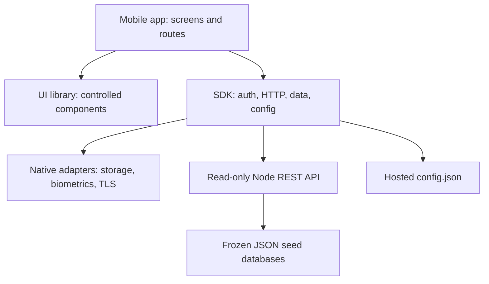
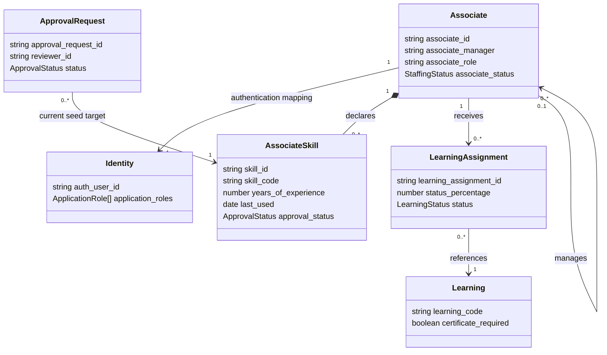
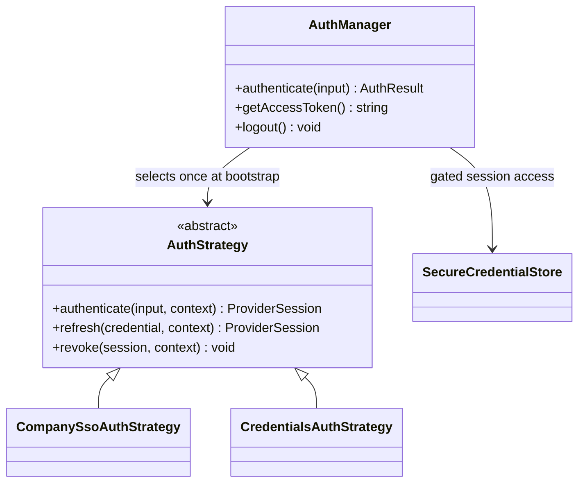
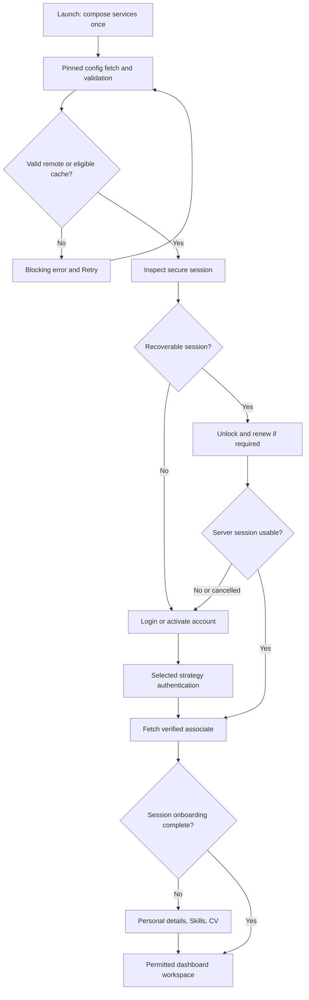
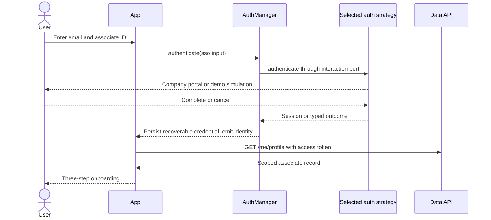
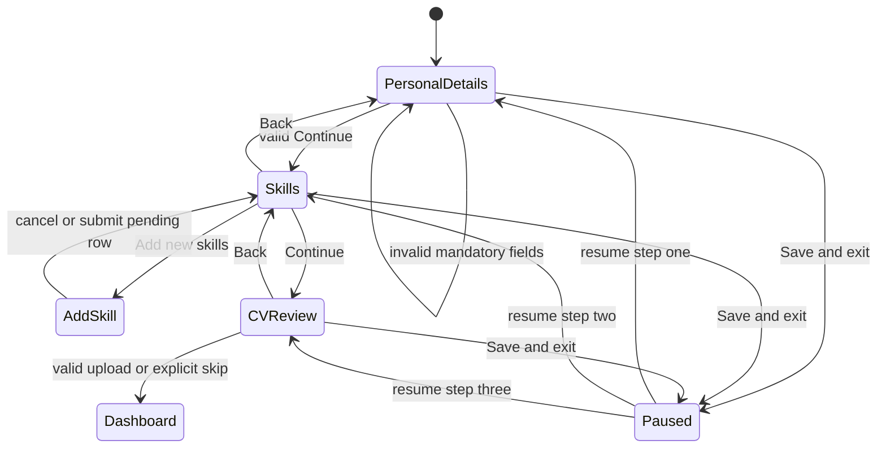
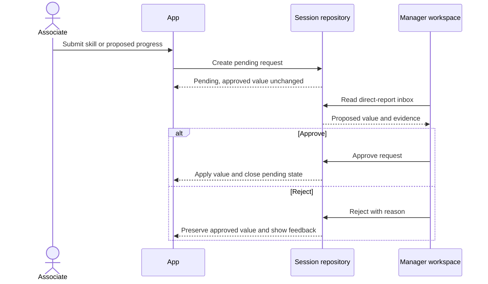
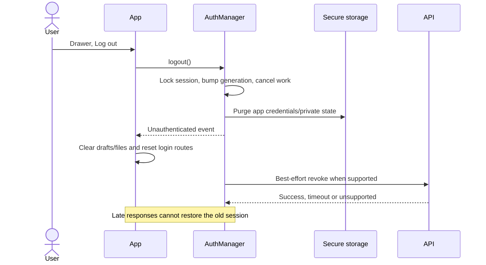

> Superseded on repository/work planning: use the [current monorepo learning solution design](10-human-learning-implementation-plan.md) and [human backlog](../user-stories/README.md). Three separate repositories and old US estimates below are historical. Technical contracts still apply where they do not conflict.

# System solution design and diagrams

This is the detailed system view for [all mobile UX requirements](./05-mobile-ui-ux-specification.md). Mermaid class, sequence and state diagrams provide UML-style models directly renderable in GitHub Markdown; flowcharts describe components and decision paths. No external PlantUML renderer is required. Source code, API delivery and target design are distinguished below.

## Scope and implemented baseline

Implemented: structured JSON fixtures, self-contained mobile HTML prototype, and read-only built-in Node HTTP server. Designed but not yet implemented: three independent React Native/SDK/UI repositories, native authentication/biometrics, secure storage, native pinning, remote configuration deployment and production domain writes. Current browser mutations live only in memory. The server does not receive them automatically.

## Component dependencies

Only the app composes user journeys. UI components emit events; SDK services emit typed results/state. Repository boundaries, package releases and every UX ownership assignment are in [work streams](06-repositories-and-workstreams.md). Server endpoint types are in [API reference](../../dummy-backend/API.md).

## Data model

IDs remain strings. No circular manager links or self-management. Application roles and job titles remain distinct. Learning.skills is a catalogue tag list, not a substitute for an associate’s experience records. Current approval seeds reference skills; progress approval types are a target extension. [Data contract](../../dummy-backend/DB/data-contract.md) defines skills and approvals.

## Authentication class model

Two strategies are configurable per app; this app chooses company SSO. Manager owns refresh/persistence/races. App implements interaction/navigation ports and selects screens. See [auth contracts](07-auth-strategy-contract.md) for signatures and failure rules.

## Launch and returning-session flow

Config pin trust is bundled, never supplied by the first untrusted response. The HTTP dummy server does not fulfil native pinning. Biometric success alone does not authenticate the remote account. No domain draft survives process termination in the demo contract.

## First-login sequence

The demo /auth/demo checks fictional email/ID and issues only an expiring access token. Production SSO is external authentication, not the embedded demo portal. A future provider adapter may supply refresh credentials; the current dummy server does not.

## Onboarding state model

Personal details requires name, phone and address. Organisation fields are visible/read-only. Skills form is initially hidden. User input survives back/paused transitions within the same session. The detailed UI specification, not this state diagram alone, defines validation and incomplete-form behaviour.

## Approval workflow

This diagram models the app-session mock contract. Equivalent real writes are future API contracts and currently return 405 on the read-only service. Decision application must be atomic in a real backend; double decisions require conflict handling.

## Logout and race handling

The read-only server has no revocation endpoint. Native/local logout is still mandatory; copied demo tokens remain valid until expiry/restart. Browser prototype cleanup is not evidence of native secure-store cleanup.

## Runtime configuration, quality and rollout

- [Runtime config](08-runtime-configuration.md) defines trusted bootstrap, allowed changes, schema/revision/expiry validation and bounded cache use.
- [API reference](../../dummy-backend/API.md) defines URL, headers, request/response types, scope and implemented errors; [OpenAPI](../../dummy-backend/openapi.json) is machine-readable for implemented routes only.
- [Detailed user stories](../user-stories/02-detailed-backlog-and-estimates.md) provide ownership, dependencies, acceptance, tests and estimates. Development gates follow contract → package foundations → auth → onboarding → roles → config/device assurance.
- Device gates: biometric cancel/lockout, secure-store failures, release-style pinning, keyboard/back/safe areas, screen readers, text scaling, reduced motion/transparency and process-kill reset.
- Avoid logging credentials/documents. Production identity, file safety, mutation auditing, conflict/idempotency and retention require backend work beyond this read-only server.
