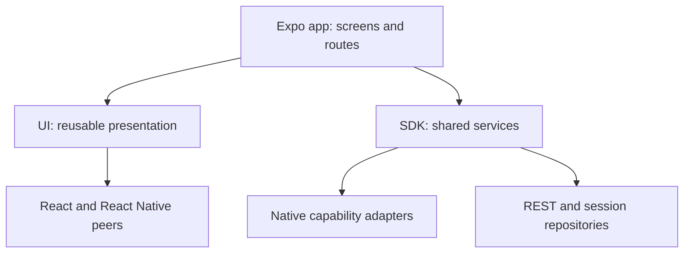

# Learning solution design: CTS Talent Readiness

Status: authoritative implementation starting point, 23 November 2026. This replaces the earlier three-independent-repository decision and feature-first backlog. The existing Git repository becomes one npm monorepo containing three independently structured product projects: UI library, SDK and mobile app. Do not create nested Git repositories. Their release/import boundaries permit a later split if required.

## Purpose and current state

Humans will implement this project to learn. Stories explain what to build, why, where to start and how to demonstrate understanding. No native UI/SDK/app scaffolding is generated by this documentation update. The HTML prototype is a reference, not code to paste wholesale into React Native.

Present: 40 people, structured skill/approval seeds, 10 learnings, 142 learning assignments, read-only Node API, OpenAPI and mobile HTML prototype. Intentionally missing: workspace manifest/lockfile, TS projects, Expo app, reusable packages, CI, package distribution and native tests. Passing backend tests does not establish future UI/SDK/app coverage.

## Proposed directories

Create these during foundation stories; existing documentation stays where it is.

| Path | Responsibility |
| --- | --- |
| package.json, package-lock.json | Private workspace root, aggregate commands, one dependency lock |
| tsconfig.base.json | Strict common rules; each project extends compatible settings |
| packages/ui | Reusable React Native components/tokens; independently publishable |
| packages/sdk | TypeScript core plus separately exported RN adapters |
| apps/mobile | Expo development-build application and business UX |
| dummy-backend | Existing independent read-only API, included as support workspace |
| requirements, solution-design, user-stories | Reviewed reference material |

Root workspaces: apps/*, packages/*, dummy-backend. Root/app/backend remain private. Choose an owned npm scope; @your-scope/talent-ui and @your-scope/talent-sdk are placeholders, not an assumed company registry account. Never package dummy employee/CV data or credentials accidentally.

UI never imports SDK/app. SDK core imports no UI, app routes or RN globals. Native bindings use a separate SDK export such as sdk/react-native. App owns route graph and ultimate UX. Inject ports rather than global navigator/token singletons.

## UI component inventory

Each row has its own learner story or cohesive group. Components accept controlled values/callbacks, include accessibility and required loading/error/disabled states, and avoid employee policy.

| Story | Components | Learning focus |
| --- | --- | --- |
| UI-01 | ThemeProvider, tokens, Text, Icon | Semantic colours, type scaling and theme contracts |
| UI-02 | Box, Stack, Divider, ScreenContainer, SectionHeader | Flexbox, safe areas and keyboard-friendly composition |
| UI-03 | Button, IconButton, Link | Variants, full-width actions, pending and touch targets |
| UI-04 | Form, FormItem, TextField, ReadOnlyField, TextArea | Controlled values, labels, errors and focus |
| UI-05 | PhoneField, SearchField, Select/Combobox, DateField | Platform input, search/selection and dates |
| UI-06 | Checkbox, CheckboxGroup, help/error summary | Selection semantics and required state |
| UI-07 | AppHeader, Avatar | Header slots, initials/image and insets |
| UI-08 | Card, StatusBadge, InlineAlert | Composition and text-based status |
| UI-09 | ProgressBar, ProgressLabel | Bounded values and approved/proposed distinction |
| UI-10 | StepTimeline, BottomTabs | Controlled navigation indicators and permissions supplied by caller |
| UI-11 | DataTable and horizontal-scroll hint | Narrow screens, long values and stable row identity |
| UI-12 | SideDrawer, BottomSheet, Dialog | Animation, focus, back/backdrop/toggle dismissal |
| UI-13 | FilePickerField presentation, FileRow, ImagePreview | Metadata/callbacks without native picker business logic |
| UI-14 | LoadingState, EmptyState, ErrorState, Toast, gallery | Consistent state UX and examples for consumers |

Drawer: right-side 60% width from under header to screen bottom, translucent navy/white labels, blur when supported, opaque accessible fallback. Login buttons stack at equal full width and minimum 54px height. All controls have minimum 48px touch targets; text scaling can increase height. Generic drawer knows neither the company URL nor logout rules.

## SDK feature inventory

| Story | Feature | Responsibility |
| --- | --- | --- |
| SDK-01 | Domain types, DTO validation, typed errors | Unions, linked IDs and response trust boundaries |
| SDK-02 | HTTP transport | JSON, timeout, abort, error mapping and injected transport |
| SDK-03 | Authenticated HTTP | Approved-origin token injection and bounded auth retry |
| SDK-04 | Secure-storage abstraction | Account/namespace isolation, native and memory adapters |
| SDK-05 | Biometrics abstraction | Availability, enrolment, cancellation/lockout and OS-gated access |
| SDK-06 | Strategy contract and CredentialsAuthStrategy | Abstract TS class, typed config, no saved passwords |
| SDK-07 | CompanySsoAuthStrategy | Dummy portal adapter versus approved external native SSO |
| SDK-08 | AuthManager authenticate/restore | No-argument recovery versus explicit input, typed outcomes/events |
| SDK-09 | Refresh and concurrency | Single-flight refresh, session generation and stale-response protection |
| SDK-10 | Logout/lifecycle | Purge, cancel requests, best-effort revoke, emit auth loss |
| SDK-11 | Navigation/interaction ports | Reusable events/contracts; no hardcoded app screen names |
| SDK-12 | Associate/identity clients | Scoped typed paged reads |
| SDK-13 | Skill/catalogue/approval clients | Owner/reviewer links and query mapping |
| SDK-14 | Learning/team/admin clients | Scope, search, paging and role errors |
| SDK-15 | Session-only mutation repositories | Profile, skills, progress, approvals, assignments, roles; no seed writes |
| SDK-16 | Files, validation and safe encoding | Lifetime/ownership, safe URLs/names and bounded inputs |
| SDK-17 | Native pinned transport | Bundled trust, current/backup pins, no unpinned fallback |
| SDK-18 | ConfigManager | Schema/bounds/revision/expiry/allowed hosts and eligible cache |
| SDK-19 | Packaging and consumer compatibility | Stable exports/types and pack/install smoke test |
| SDK-20 | Coverage and behavioural assurance | 100% authored TS metrics and negative/race tests |

Instantiate one selected strategy class and AuthManager at the app composition root. authenticate() with no arguments inspects secure storage, unlocks/renews when allowed or returns interaction_required/cancelled. Explicit input starts the selected interactive strategy. Screens never own refresh credentials. See [auth signatures](07-auth-strategy-contract.md).

The dummy API issues one-hour access tokens but no refresh token, revocation or domain writes. Refresh exercises require a clearly labelled fake provider. Session-only repositories simulate mutations; do not treat API 405 as successful persistence. Navigation ports belong to SDK; actual routes and business transitions belong to app.

## App features in user order

| Stage | Stories | Outcome |
| --- | --- | --- |
| Platform | APP-01–04 | Compatible Expo dependencies, Android/iOS development builds, environments and composition |
| First screen | APP-05–08 | Config launch gate, aligned login, activation validation and dummy company SSO |
| Returning user | APP-09 | Native biometric restore and expiry/cancel fallback |
| Onboarding | APP-10–14 | Contacts, timeline/back/pause, skills/table/reveal/validation, CV and review |
| Personal workspace | APP-15–18 | Editable dashboard, role tabs, proposed progress and rejection feedback |
| Team | APP-19–20 | Manager approvals, direct-report search and assignments |
| Admin | APP-21 | Additive roles and access safeguards |
| Account/lifecycle | APP-22–23 | Drawer, portal, logout, process reset and account isolation |
| Assurance | APP-24–25 | App coverage, accessibility and complete phone demonstration |

Proposed routing choice: React Navigation in a blank TypeScript Expo app. Do not also install Expo Router merely because another template includes it. If learners choose a Router template, record that decision and update setup instructions consistently. SDK ports remain navigation-framework-neutral.

## Dependency plan: select compatible versions during setup

| Scope | Dependencies/families | Reason |
| --- | --- | --- |
| Root dev | npm workspaces, TypeScript, ESLint/formatter, Jest, CI and release/version tooling | Repeatability; Nx/Turbo are optional stretch tools |
| UI peers | React, React Native | Avoid duplicate runtimes; align with Expo app |
| UI dev | RN testing library and compatible RN/Expo test preset | Render/interact rather than snapshot-only tests |
| SDK core | TypeScript and optional schema validator; injected HTTP | Core imports work in Node without device globals |
| SDK native entry | Chosen secure store, local authentication, files, auth session and pinning integration | Declare peers/plugins/build needs explicitly |
| App runtime | Expo, compatible React/RN, expo-dev-client, React Navigation and required safe-area/screens packages, UI/SDK | App controls navigation and services |
| Feature candidates | react-hook-form, one selected schema validator, document/image picker, file system and blur packages | Add only for an actual feature; avoid overlapping state/validation systems |
| App dev | Jest, jest-expo, RN testing library and matching types | Expo-native transforms/mocks rather than incompatible copied Jest config |

No exact versions are claimed compatible yet. Learners record Node/npm/Expo/RN/React/test versions after a working spike and commit one lockfile. Use expo install for compatible Expo/native dependencies. Explain runtime versus peer versus optional peer versus development dependencies before adding one.

## npm distribution: ready without publishing

1. Workspaces provide local linking. Use matching normal semver (for example 0.1.0) for local UI/SDK dependencies; do not assume npm accepts another manager's workspace protocol.
2. Build then npm pack each package. Install tarballs in a clean consumer to discover missing exports/build files hidden by workspace source linking.
3. Registry readiness includes owned scope/host decision, tested manifests/types/exports/files, release policy, authentication documentation and dry-run workflow. It does not mean publication already happened.
4. npmjs can host packages; a new registry server is not required. Local Verdaccio is optional. Explicitly decide public/private access and confirm account/plan requirements. Default learning path stays local until a human chooses to publish.
5. Never commit registry credentials. Account login, 2FA/trusted publishing and actual publication are human tasks. Validate tarball contents; do not ship fixtures, secrets or copied company artwork.

## Expo environments and runbook contract

Create development, test and production-shaped bootstraps with public settings, not real credentials. Client-exposed Expo variables are not secret storage. A bundled trusted bootstrap selects config host/pins/identity settings; remote config adjusts shipped labels/flags/limits only. It cannot disable pinning or install native code.

Use Expo development builds for final native capabilities. Expo Go can show initial UI but is not acceptance evidence for custom pinning or arbitrary native bindings. Android local setup requires Android Studio/SDK/JDK matched to Expo. Local iOS simulator requires macOS/Xcode: Windows cannot run it locally. Cloud builds and physical devices are a separate workflow, not a Windows local iOS simulator.

After APP-01 scaffolding, from apps/mobile: install expo-dev-client with Expo, use npx expo run:android for a local Android build, or npx expo run:ios on macOS; then npx expo start --dev-client for JS iteration. Rebuild native binaries after native dependencies/config change. Record actual successful commands and device/build versions. Do not mark a story done after only generating files.

Start the read API from dummy-backend with npm start. Default: loopback HTTP port 3001. Android emulator normally reaches the host through 10.0.2.2; iOS simulator can use host localhost. Physical devices need an intentionally reachable dev endpoint. Initial local HTTP and later trusted HTTPS/pinning are separate test gates; never disable certificate validation to pass a test.

## Mandatory testing policy

| Workspace | Statements | Branches | Functions | Lines |
| --- | --- | --- | --- | --- |
| SDK owned executable TS, including native wrappers | 100% | 100% | 100% | 100% |
| UI owned TS/TSX | 90% | 90% | 90% | 90% |
| App owned TS/TSX | 70% | 70% | 70% | 70% |

Set up unit tests in each workspace before implementation. Root commands aggregate without hiding failing projects. Collect from all owned executable src files, including unimported files. Exclude only generated outputs/declarations, tests, fixtures and explicit gallery-only code. Do not exempt adapters/error paths/auth logic merely to pass. SDK adapter wrappers are unit-tested with injected fakes; OS behaviour still needs real-device verification. Third-party native internals are outside JS coverage; authored Swift/Kotlin requires a separately documented native test gate.

SDK core uses Node tests via Jest; UI/app use compatible RN/Expo presets. Fail CI on any metric below target. Demonstrate a failing threshold by temporarily adding an uncovered branch, then restore the correct state. Type-only files have no executable coverage but must type-check. A high percentage is not a substitute for wrong-role, expiry, race, invalid-file or untrusted-config tests.

## Learning process and references

Follow [learning backlog](../user-stories/README.md): foundations → UI → SDK → app. Each story includes concrete work, prerequisites, learning context, hints, acceptance, negative tests and a human demonstration. Reviewer asks the implementer to explain a trade-off/failure rather than accept unexplained generated code. Estimates separate focused engineering from learner pace; they are not dates.

Official references checked 23 November 2026:

- [Expo monorepos](https://docs.expo.dev/guides/monorepos/)
- [Expo development builds](https://docs.expo.dev/develop/development-builds/introduction/)
- [Expo unit testing](https://docs.expo.dev/develop/unit-testing/)
- [npm workspaces](https://docs.npmjs.com/cli/using-npm/workspaces/)
- [npm manifests](https://docs.npmjs.com/cli/configuring-npm/package-json/)
- [npm scoped publication](https://docs.npmjs.com/creating-and-publishing-scoped-public-packages/)
- [Jest coverage thresholds](https://jestjs.io/docs/configuration#coveragethreshold-object)
