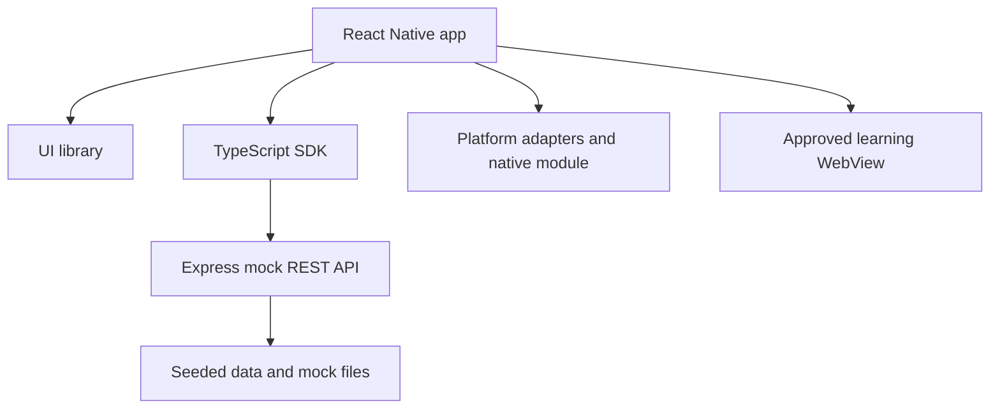

> Superseded on repository/work planning: use the [current monorepo learning solution design](10-human-learning-implementation-plan.md) and [human backlog](../user-stories/README.md). Three separate repositories and old US estimates below are historical. Technical contracts still apply where they do not conflict.

> Initial design baseline. Where behaviour differs, [current agreed requirements](../requirements/00-current-requirements.md) take precedence.

# Architecture and repository strategy

## Proposed starting point

Use Expo development builds with TypeScript for the RN application. Expo Go can support the first UI exercise but is not the target runtime for custom native modules and pinning. Validate the selected native libraries in a short Android/iOS build spike before committing versions.

Use npm workspaces in one repository initially: it simplifies local package iteration for beginners. If separate repositories are required as a learning exercise, move the same package boundaries to independently versioned repositories and consume published private package versions rather than ad hoc source copies.

| Proposed path | Responsibility | Allowed dependencies |
| --- | --- | --- |
| apps/mobile | Screens, routing, feature composition, platform adapters | UI, SDK, contracts |
| packages/ui | Tokens and RN presentation components | React, RN peer dependencies |
| packages/sdk | REST client, domain operations, validation, typed errors | Contracts; injected transport/storage |
| packages/contracts | Transport schemas and DTOs | No mobile or Express dependencies |
| services/mock-api | Express routes, policy checks, fixtures, file storage | Contracts |
| apps/learning-web | Small controlled WebView learning page | Bridge contract only |
| packages/native-capabilities | Typed wrapper and Android/iOS implementations | Native platform APIs |
| docs | Requirements, designs, ADRs, runbooks | None |

These directories are a future implementation layout; the current deliverable contains documentation only.

Feature folders own screens, hooks, validation and tests for auth, profile, assignments, team and administration. App composition owns dependency injection. UI packages do not fetch data; SDK does not render UI. Runtime validation supplements compile-time types at network, config and bridge boundaries.

Teach tooling explicitly: package.json scripts/exports/peerDependencies, lockfiles, npm install versus npm ci, TypeScript compilation, Babel transformation, Metro resolution, assets and native builds. Pin mutually compatible versions after the spike; do not teach bundling as a substitute for native compilation.
